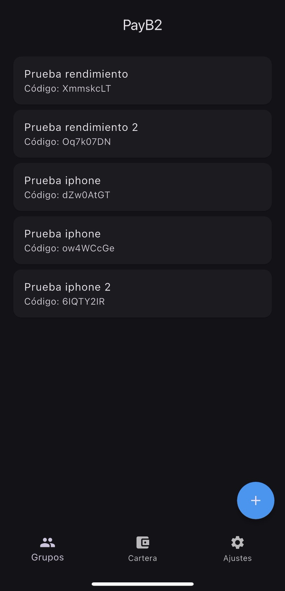
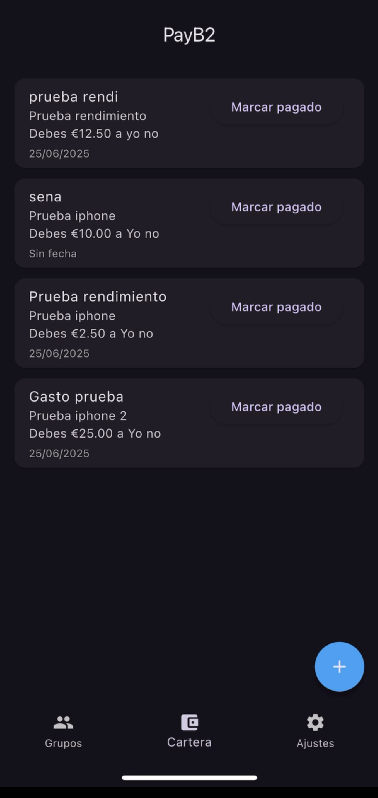
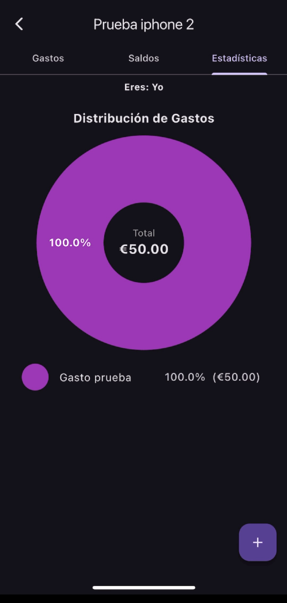

# 💸 PayB2

**PayB2** es una aplicación móvil desarrollada en Flutter que permite gestionar gastos compartidos de forma rápida, sencilla y sincronizada entre usuarios. Ideal para grupos de amigos, compañeros de piso o viajes.

Desarrollado por **Alexander Caiza** como Trabajo de Fin de Grado en Ingeniería Multimedia.

---

## 🚀 Funcionalidades principales

- 📱 Crear y unirse a grupos con otros usuarios.
- 🧾 Añadir gastos y dividirlos entre los miembros.
- 🔔 Notificaciones push al marcar deudas como pagadas.
- 🔄 Gastos periódicos automáticos (semanales, mensuales, anuales...).
- 💰 Vista de saldos con detalle de deudas.
- 📡 Sincronización en tiempo real mediante Firebase.

---

## 🛠️ Tecnologías utilizadas

- **Flutter** (Dart)
- **Firebase**: Firestore, Cloud Functions, Cloud Messaging, Authentication
- **Xcode** / **Android Studio** (para pruebas en dispositivos físicos y simuladores)
- **DevTools**, **Xcode Instruments**, **Time Profiler** (pruebas de rendimiento)

---

## 📦 Instalación del proyecto

1. **Clona el repositorio:**

```bash
git clone https://github.com/alexanci05/payb2.git
cd payb2
```

2. **Instala dependencias:**

```bash
flutter pub get
npm --prefix functions ci
```

3. **Arranca Firebase local:**

Se necesitan Node.js 22 y Java 21. No hace falta una cuenta de Firebase, activar facturación ni añadir credenciales. Desde la raíz, en una terminal:

```bash
npm --prefix functions start
```

La suite usa `demo-payb2` y escucha solo en este ordenador. Su interfaz local está en `http://127.0.0.1:4000`.

4. **Ejecuta la aplicación en otra terminal:**

```bash
flutter run
```

El entorno predeterminado utiliza emuladores de Auth, Firestore y Functions: `10.0.2.2` en el emulador Android y `127.0.0.1` en el simulador iOS. No cambia al proyecto real si los emuladores están apagados. Las notificaciones push no están disponibles en este entorno.

Para un Android físico conectado por USB:

```bash
adb reverse tcp:9099 tcp:9099
adb reverse tcp:8080 tcp:8080
adb reverse tcp:5001 tcp:5001
flutter run --dart-define=FIREBASE_EMULATOR_HOST=127.0.0.1
```

En macOS, si la terminal usa Java 17, puede seleccionarse el Java 21 incluido con Android Studio antes de arrancar los emuladores:

```bash
export JAVA_HOME="/Applications/Android Studio.app/Contents/jbr/Contents/Home"
export PATH="$JAVA_HOME/bin:$PATH"
```

Para conectar con Firebase de producción, compila con `--dart-define=FIREBASE_ENV=production` y configura App Check para la aplicación registrada. Para una release Android, usa [`android/key.properties.example`](android/key.properties.example) como plantilla para `android/key.properties` y guarda el almacén de claves y sus contraseñas fuera de Git. Para iOS, usa un perfil de aprovisionamiento que admita App Attest. Comprueba la acreditación en un dispositivo físico antes de distribuir la aplicación.

---

## 🧪 Pruebas y rendimiento

El rendimiento se ha evaluado mediante:

- Flutter DevTools: análisis de uso de CPU, jank, renderizado de frames, etc.
- Xcode Instruments: control de uso de CPU y análisis con Time Profiler en iOS.

---

## 📷 Capturas de pantalla

### 🏠 Primera pantalla


### 👥 Vista grupos


### 💳 Cartera


### 📈 Estadisticas


---

## 📄 Licencia

Este proyecto es de uso académico y personal. No está destinado a producción comercial sin consentimiento del autor.

---

## ✍️ Autor

**Esteban Alexander Caiza Inga**

[](https://github.com/alexanci05)  
[](https://www.linkedin.com/in/alexanci)


